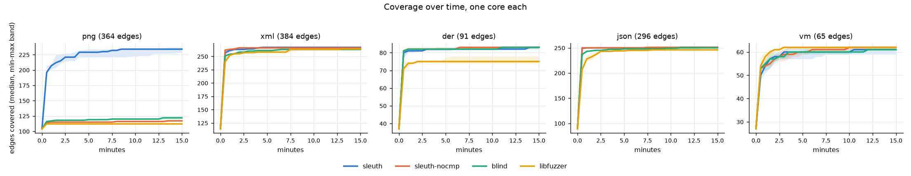
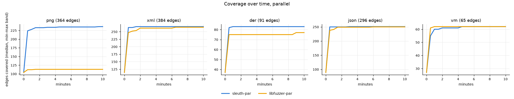

# Sleuth

A coverage-guided fuzzer written from scratch, and an honest comparison of it with libFuzzer on
five small parsers with 20 planted, documented bugs.

- **C++**: the instrumentation runtime and the fuzzer. Edge coverage comes from clang's
  SanitizerCoverage pass (`trace-pc-guard`, `trace-cmp`), with callbacks written here, not taken
  from libFuzzer. The C++ side also holds the mutation loop, crash deduplication and the crash
  minimizer.
- **Rust**: a parallel mode. It runs one worker per core with a shared, curated corpus, and
  serves an HTTP API for the dashboard.
- **Python**: campaigns (many runs at once, with repetitions) and their analysis. Coverage is
  re-measured the same way for every fuzzer, and bug times come from canaries.
- **TypeScript**: a dashboard with live campaign state, coverage over time, crashes, and the
  measured results.

**Results in brief** (15-minute runs on one core each, 3 repetitions; parallel runs on 8 cores, 10 minutes):

| | Sleuth | Sleuth without comparison feedback | blind (no coverage) | libFuzzer | Sleuth, 8 cores | libFuzzer, 8 cores |
|---|---|---|---|---|---|---|
| planted bugs detected (of 20) | 13 | 13 | 13 | 11 | **15** | 11 |
| PNG edges reached (median) | **234** | 117 | 122 | 112 | **236** | 113 |

- **PNG is the clearest result.** Sleuth reaches twice the code that every other fuzzer reaches.
  The others stall at the first chunk CRC; checksum repair and input-to-state get Sleuth through
  it into the decoder. Sleuth is also the only fuzzer that finds a PNG bug (3, and 4 with
  8 cores).
- **On the other four targets the fuzzers end within a few edges of each other.** Most of the
  planted bugs there are found by every fuzzer in seconds, the blind baseline included. The
  targets are too shallow to separate the fuzzers on those bugs; that is a limit of this
  benchmark, and it is stated as such.
- **Four bugs were found by no fuzzer:** 1, 2, 7 and 16. They need a 769+ byte palette, a
  300-byte `tRNS` chunk, 17 attributes or 65 keys.

## How it works

### Instrumentation (`runtime/`)

A target is compiled with `-fsanitize=address -fsanitize-coverage=trace-pc-guard,trace-cmp` and
linked with `runtime/sleuth_rt.cpp`. The runtime itself is compiled without coverage
instrumentation. It provides:

- `__sanitizer_cov_trace_pc_guard_init` / `_guard`. Every edge gets an id and a hit counter.
  After a run, only the edges that were touched are reported, bucketed by hit count like AFL
  (1, 2, 3, 4–7, 8–15, 16–31, 32–127, 128+). A loop running 5 times is therefore different from
  one running 50 times.
- `__sanitizer_cov_trace_cmp*` / `_const_cmp*` / `_switch`. These record the operands of integer
  comparisons, and whether one side is a compile-time constant.
- `__sanitizer_weak_hook_memcmp` / `strcmp` / `strncmp` / `strstr`. Through them, the
  AddressSanitizer interceptors also report string comparisons such as `memcmp(p, "<![CDATA[", 9)`.
- `main()`, with three modes:
  - `--sleuth-child`, the persistent mode. Inputs arrive as frames on stdin, and each answer
    (edges, comparisons) goes back on a duplicate of stdout. The target's own stdout goes to the
    null device.
  - `--replay FILE...` prints the edges each file reaches. It is used to measure every fuzzer's
    coverage the same way.
  - `FILE` reproduces a single input.

The controller asks for comparisons per input, at one of three levels:

| Level | What the child reports | Used for |
|---|---|---|
| none | no comparisons | blind and `--no-cmp` runs |
| light | the first 32 comparisons between two run-time values of 4 or 8 bytes | checksum repair |
| full | every comparison, plus the string comparisons | each input that is kept |

Reporting every comparison for every input halved the speed. Measured alone on the PNG target,
Sleuth ran at 8,000 executions/s with full reports for every input, at 13,000 with the light
level, and at 16,700 with no comparisons at all.

### The fuzz loop (`fuzzer/src/`)

- **Feedback.** An input enters the corpus when it reaches an edge, or an edge hit-count
  bucket, that no earlier input reached (AFL's "virgin bits").
- **Scheduling.** A *favored* subset is fuzzed first: it covers every edge seen so far with the
  fastest and smallest entries, as in AFL. Each turn's energy depends on four things:
  - the entry's speed;
  - how rare its rarest edge is across all executions so far (rare edges are the frontier);
  - whether it is fresh;
  - how often its mutants crash with a *known* signature. On Windows a crash costs a process
    restart of about 65 ms, so entries whose mutants mostly crash in known ways are throttled.
- **Mutations.**
  - Havoc stacks 2–16 edits: bit flips, interesting values in both byte orders, arithmetic,
    random bytes, deleting, duplicating and copying blocks, dictionary tokens, learned
    comparison operands, and blocks from other entries.
  - Splicing.
  - Input-to-state, a RedQueen-lite stage, on each entry's first turn. For every comparison the
    target made, it finds one operand's bytes in the input and puts the other operand there
    (also ±1, in both byte orders). String comparisons are handled the same way.
- **Checksum repair.** When a mutant brings nothing new, the controller looks at its light
  comparisons: comparisons between two run-time values, such as a computed CRC against the
  stored one. If one value occurs exactly once in the input, the repaired input is run too.
  This is what gets havoc past PNG's per-chunk CRC-32: without it, nearly every mutation of a
  PNG dies at the first CRC check.
- **Crashes.**
  - The children run with `symbolize=0`, which makes a crash about 40% cheaper. A crash's
    unsymbolized signature (module + offset frames) is looked up in a cache. Only a new one is
    re-run once with symbolization to get its readable signature.
  - The signature is the sanitizer's error kind, the faulting frame with its line, and the
    names of the next two calling functions. Sanitizer, C library and harness frames are
    skipped, and recursion is collapsed, so the same bug reached at another recursion depth
    keeps its signature.
  - `sleuth tmin` minimizes a crash while keeping its signature. It uses delta debugging:
    remove blocks of size n/2, n/4, ... 1, then normalize the bytes that do not matter to `0`.
  - `sleuth triage` prints the signature of any input.
- **Hangs.** A watchdog thread kills the child when an input passes its deadline. Polling every
  5 ms keeps the normal path free of thread wake-ups.

### Parallel mode (`parallel/`, Rust)

`sleuth-parallel` starts N `sleuth fuzz` workers, by default one per logical core.

1. Every input a worker adds to its own corpus is also written to
   `sync/worker-K/queue/`, with the edges it covers.
2. The supervisor keeps a global map of the (edge, bucket) pairs that any worker has reached.
3. It publishes an input to `sync/shared/` only if the input adds to that global map.
4. Workers import from `sync/shared/` every few seconds.

As a result, an input found by one worker reaches the others once, and inputs that only repeat
what is already known stay private. The supervisor also merges the workers' statistics and
crashes, deduplicating them by signature, and serves them over HTTP with the dashboard.

### Dashboard (`web/`, TypeScript)

The dashboard has two views:

- **Live** polls a running `sleuth-parallel --port P`. It shows executions, global coverage
  over time and the deduplicated crashes.
- **Measured results** reads `campaign.json`, written by `eval/analyze.py`. It shows coverage
  curves per target (median and min–max band), the bug table, and per-run statistics.

## Targets and planted bugs

There are five parsers written for this project: PNG (with its own inflate), XML, DER (X.509's
ASN.1 encoding), JSON, and a small bytecode VM. They hold **20 planted bugs**, each guarded by a
Magma-style canary that logs when the bug's line is *reached* and when its condition is
*triggered*. A third level, *detected*, means that a crash was reported and its input triggers
the bug. Each bug has a proof-of-concept input, and the tests check that every one triggers its
canary and is caught by AddressSanitizer. The list is in [targets/BUGS.md](targets/BUGS.md).

### What was not used, and why

- **AFL++ was not run.** Comparing against it would mean downloading and building an external
  fuzzer, and the project's rule is not to run external binaries. The comparison is with
  **libFuzzer**, which ships with the clang used to build everything here.
- **Magma and FuzzBench targets were not used.** libpng, libxml2 and openssl with Magma's
  patches would also be third-party sources. The planted bugs follow Magma's method instead:
  canaries, and reached / triggered / detected. The bug classes are modelled on real ones in
  those libraries, but the code is ours.
- **No 24-hour runs.** The campaigns are 15 minutes (one core) and 10 minutes (parallel), with
  repetitions. The targets are small enough that most curves flatten well before the end.

## Evaluation

### Setup

- **Machine and runs.** Intel i7-10870H, 8 cores / 16 threads, 16 GB, Windows 11, clang 23.1.
  The single-core runs ran 14 at a time (one per hardware thread, two threads left free); the
  parallel runs ran two at a time with 8 workers each. Every fuzzer got the same seeds
  (`targets/*/seeds`), the same dictionary, the same 4,096-byte input limit and the same
  sanitizer options.
- **libFuzzer.** It ran as `-fork=N -ignore_crashes=1`, so that it keeps going after a crash, as
  Sleuth does. Its own runtime and instrumentation come from the same clang.
- **Coverage.** Each fuzzer's saved inputs (Sleuth's queue, libFuzzer's corpus, the inputs where
  blind mode reached something new) were replayed through the *same* Sleuth build of the target.
  A curve point is the number of distinct edges reached by the inputs saved up to that time.
  Neither fuzzer's own counter is used.
- **Bugs.** Times come from the canary logs (`R`/`T` lines with timestamps). *Detected* means
  that a saved crash input, run again alone, triggers the bug (the last bug it triggers). Medians
  over the 3 runs are shown only when at least 2 of 3 runs found the bug; a miss counts as "after
  15 minutes".

Raw runs (not committed) are reproduced with the commands under
[Build and run](#build-and-run). The analysis is in [results/summary.json](results/summary.json)
and [results/bugs.md](results/bugs.md). The dashboard's results view shows the same data.

### Coverage





| target (edges) | Sleuth | no cmp | blind | libFuzzer | Sleuth ×8 | libFuzzer ×8 |
|---|---|---|---|---|---|---|
| png (364) | **234** | 117 | 122 | 112 | **236** | 113 |
| xml (384) | 267 | 266 | 263 | 264 | 267 | 265 |
| der (91) | 83 | 83 | 83 | 75 | 83 | 77 |
| json (296) | 251 | 251 | 250 | 246 | 251 | 250 |
| vm (65) | 61 | 62 | 61 | 62 | 62 | 62 |

The table shows the median edges after 15 minutes (10 for the 8-core runs). The bands in the
plots are narrow: the three runs end within 1–4 edges of each other everywhere except Sleuth on
PNG (228–237).

- **PNG.** This is where the comparison feedback matters. Every chunk ends with a CRC-32 that is
  checked before the chunk is used. The comparison of the computed and stored CRCs is between
  two run-time values. Checksum repair copies the computed CRC over the stored one, and the
  mutated chunk survives. Without it (`sleuth-nocmp`), Sleuth is no better than blind fuzzing.
  libFuzzer's comparison tracing (its "table of recent compares") does not fix the CRC either:
  it stays at 112.
- **DER.** libFuzzer reaches fewer edges (75 vs 83) and misses bug 11 (more than 16 OID arcs).
  The difference is in the mutations, not the feedback: blind mode reaches 83 too. Sleuth's havoc
  duplicates and inserts blocks more often, and DER rewards that.

### Planted bugs

T = triggered, D = detected. Each cell shows the runs that found the bug out of the runs made,
then the median time.

| bug | target | sleuth | sleuth-nocmp | blind | libfuzzer | sleuth-par | libfuzzer-par |
|---|---|---|---|---|---|---|---|
| 1 | png | T -, D - | T -, D - | T -, D - | T -, D - | T -, D - | T -, D - |
| 2 | png | T -, D - | T -, D - | T -, D - | T -, D - | T -, D - | T -, D - |
| 3 | png | T 3/3 (0s), D 3/3 (2s) | T -, D - | T -, D - | T -, D - | T 1/1 (1s), D 1/1 (2s) | T -, D - |
| 4 | png | T -, D - | T -, D - | T -, D - | T -, D - | T 1/1 (27s), D 1/1 (28s) | T -, D - |
| 5 | png | T 3/3 (2s), D - | T -, D - | T -, D - | T -, D - | T 1/1 (1s), D - | T -, D - |
| 6 | xml | T 3/3 (27s), D 3/3 (27s) | T 3/3 (70s), D 3/3 (70s) | T 3/3 (119s), D 3/3 (120s) | T 3/3 (56s), D 3/3 (56s) | T 1/1 (14s), D 1/1 (15s) | T 1/1 (46s), D 1/1 (47s) |
| 7 | xml | T -, D - | T -, D - | T -, D - | T -, D - | T -, D - | T -, D - |
| 8 | xml | T 3/3 (2s), D 3/3 (1s) | T 3/3 (2s), D 3/3 (2s) | T 3/3 (3s), D 3/3 (1s) | T 3/3 (118s), D 3/3 (21s) | T 1/1 (2s), D 1/1 (2s) | T 1/1 (15s), D 1/1 (6s) |
| 9 | xml | T 3/3 (10s), D 3/3 (10s) | T 3/3 (5s), D 3/3 (6s) | T 3/3 (4s), D 3/3 (4s) | T 3/3 (72s), D 3/3 (72s) | T 1/1 (2s), D 1/1 (3s) | T 1/1 (3s), D 1/1 (4s) |
| 10 | der | T 3/3 (2s), D 3/3 (3s) | T 3/3 (2s), D 3/3 (2s) | T 3/3 (2s), D 3/3 (2s) | T 3/3 (2s), D 3/3 (3s) | T 1/1 (2s), D 1/1 (3s) | T 1/1 (2s), D 1/1 (2s) |
| 11 | der | T 3/3 (3s), D 3/3 (4s) | T 3/3 (7s), D 3/3 (8s) | T 3/3 (8s), D 3/3 (8s) | T -, D - | T 1/1 (4s), D 1/1 (5s) | T -, D - |
| 12 | der | T 3/3 (0s), D 3/3 (1s) | T 3/3 (1s), D 3/3 (1s) | T 3/3 (1s), D 3/3 (1s) | T 3/3 (4s), D 3/3 (8s) | T 1/1 (1s), D 1/1 (1s) | T 1/1 (1s), D 1/1 (2s) |
| 13 | der | T -, D - | T 3/3 (256s), D 3/3 (257s) | T 2/3 (861s), D 2/3 (862s) | T -, D - | T 1/1 (142s), D 1/1 (143s) | T -, D - |
| 14 | json | T 3/3 (2s), D 3/3 (3s) | T 3/3 (4s), D 3/3 (16s) | T 3/3 (2s), D 3/3 (3s) | T 3/3 (12s), D 3/3 (16s) | T 1/1 (2s), D 1/1 (5s) | T 1/1 (2s), D 1/1 (5s) |
| 15 | json | T 3/3 (4s), D 3/3 (5s) | T 3/3 (1s), D 3/3 (2s) | T 3/3 (1s), D 3/3 (1s) | T 3/3 (3s), D 3/3 (3s) | T 1/1 (2s), D 1/1 (4s) | T 1/1 (3s), D 1/1 (4s) |
| 16 | json | T -, D - | T -, D - | T -, D - | T -, D - | T -, D - | T -, D - |
| 17 | vm | T 3/3 (2s), D 3/3 (4s) | T 3/3 (1s), D 3/3 (2s) | T 3/3 (0s), D 3/3 (3s) | T 3/3 (2s), D 3/3 (2s) | T 1/1 (1s), D 1/1 (2s) | T 1/1 (2s), D 1/1 (2s) |
| 18 | vm | T 3/3 (3s), D 3/3 (4s) | T 3/3 (4s), D 3/3 (5s) | T 3/3 (3s), D 3/3 (3s) | T 3/3 (4s), D 3/3 (11s) | T 1/1 (1s), D 1/1 (2s) | T 1/1 (2s), D 1/1 (4s) |
| 19 | vm | T 3/3 (2s), D 3/3 (2s) | T 3/3 (2s), D 3/3 (3s) | T 3/3 (2s), D 3/3 (3s) | T 3/3 (3s), D 3/3 (6s) | T 1/1 (1s), D 1/1 (2s) | T 1/1 (1s), D 1/1 (1s) |
| 20 | vm | T 3/3 (1s), D 3/3 (2s) | T 3/3 (4s), D 3/3 (5s) | T 3/3 (2s), D 3/3 (2s) | T 3/3 (8s), D 3/3 (8s) | T 1/1 (1s), D 1/1 (2s) | T 1/1 (2s), D 1/1 (2s) |

What the table says:

- **Bugs 17–20 (VM) and 10, 12, 14, 15 are found by every fuzzer within seconds**, blind mode
  included. They need one wrong byte in the right place, and the seeds are already close. Bugs 6
  and 9 take longer, but blind mode finds them as well.
- **Bug 3 (`tEXt` without a NUL)** is behind the PNG CRC. Only Sleuth gets there, in under
  2 seconds in every run. Bug 4 (Paeth filter on the first row) needs a valid compressed image
  with filter type 4. Only the 8-core Sleuth run found it, after 28 s. Bug 5 (size overflow) is
  triggered by Sleuth in every run, but never detected: the wrapped size is only overflowed when
  enough rows of image data follow, and none of the inputs had them. This is Magma's
  triggered-but-not-detected case.
- **Bug 13 (UTCTime longer than 13 characters) goes the other way.** It was found by
  `sleuth-nocmp` (3/3, about 4 minutes), by blind mode (2/3) and by the 8-core Sleuth run, but by
  none of the single-core Sleuth runs.
  - Our reading is a guess, not something we measured. The full Sleuth spends its time on the
    entries input-to-state opened up, deeper in the certificate. Bug 13 needs a long run of
    digits in a UTCTime, which plain havoc on the seed builds just as well.
  - With 3 runs per fuzzer this is one observation, not a statistically supported difference.
- **libFuzzer found 11 of 20.** It missed bug 11 both on one core and on 8; every Sleuth mode and blind mode found it. On bugs 8 and 9 it is
  slower (21 s and 72 s against 1–10 s). On bug 6 it beats blind mode and `sleuth-nocmp`.
- **8 cores.** The parallel Sleuth found 15 of 20, including 4 and 13, which no single-core
  Sleuth run found. libFuzzer on 8 cores found the same 11 as on one core.

**Bug 8 measurement correction.** The canary of bug 8 was too narrow during the campaigns. It
counted the bug only when the open tag's name was also a prefix of the closing tag, but the
faulty `memcmp` reads out of bounds for any longer closing tag. It was corrected after the runs
(`targets/xml/xml.cpp`), and the crash inputs were attributed again with the corrected build.
The *detected* column for bug 8 is therefore right. The *triggered* times for bug 8 come from
logs written with the narrow canary, which is why some are later than the detection times.

### Speed

Median executions per second while running 14 at a time, or with 8 workers:

| target | Sleuth | no cmp | blind | libFuzzer | Sleuth ×8 | libFuzzer ×8 |
|---|---|---|---|---|---|---|
| png | 7,417 | 12,305 | 12,100 | 10,954 | 56,861 | 103,779 |
| xml | 2,168 | 3,047 | 1,087 | 2,508 | 17,237 | 7,590 |
| der | 1,033 | 762 | 886 | 661 | 8,379 | 3,590 |
| json | 10,114 | 9,716 | 10,545 | 2,355 | 84,140 | 8,104 |
| vm | 134 | 117 | 99 | 267 | 1,498 | 1,720 |

- **Crashes cost the most.** Sleuth runs the target in a separate process (persistent mode over
  pipes). On Windows a crash means starting a new process with AddressSanitizer, about 65 ms.
  Sleuth throttles the entries whose mutants keep crashing in known ways. On the VM target almost
  every edit of a seed can divide by zero, so every fuzzer there is crash-bound at a few hundred
  executions per second.
- **libFuzzer in fork mode pays the same cost from the other side.** Each job ends at its first
  crash, and a new job is started. On targets that crash often (json, xml, der) it is slower than
  Sleuth. On PNG, where it never gets far enough to crash, it is faster.
- **libFuzzer in-process is much faster.** Without fork mode, on PNG, it runs at about
  100,000 executions per second, against Sleuth's 13,000 when run alone. That speed cannot be
  used here, because without fork mode libFuzzer stops at the first crash.
- **The cost of comparison feedback.** Full Sleuth is slower than `sleuth-nocmp` on PNG (7.4k
  against 12.3k), because of the repaired variants and the full comparison report for every kept
  input. On PNG that cost buys twice the coverage.

### Crash deduplication

Sleuth's unique crash signatures per run, against the bugs they belong to (from the canaries):

| target | signatures | bugs |
|---|---|---|
| png | 2 | 1 |
| xml | 4 | 3 |
| der | 3 | 3 |
| json | 7–8 | 2 |
| vm | 12–13 | 4 |

- A signature is never shared by two bugs, but one bug can have several signatures:
  - **VM:** an off-by-one register index crashes at every instruction that uses a register, and
    each of those is a different line.
  - **JSON:** the same faulty number parser is reached through `value`→`array` and through
    `value`→`object`, which are different callers.
  - **PNG:** bug 3 is an ASan read past the buffer, or a null read for an empty chunk.
- libFuzzer in fork mode saves every crashing input: 156 to 3,339 files per run, with no
  deduplication.

### Limits

- The targets are small (65–384 edges) and the bugs are planted by the same author who wrote the
  fuzzer, so the bugs suit its strengths more than real ones would. PNG shows a real mechanism
  (checksum repair). The tie on the other targets mostly shows that their bugs are shallow.
- The runs last 15 minutes, with 3 repetitions. No significance tests are claimed. Where the
  three runs disagree, the table shows it (for example 2/3).
- Everything ran on Windows. Linux would change the speed numbers (cheaper process starts, a
  fork server would be possible), but probably not the coverage ranking. The CI runs the whole
  pipeline on Linux on a smaller scale.

## Build and run

You need clang (with its sanitizer and libFuzzer runtimes), Python 3, Rust and Node.js.

```bash
python targets/make_inputs.py       # seeds, proofs of concept, dictionaries
python build.py --tests             # build/: sleuth, test_fuzzer, <target>/{sleuth,libfuzzer}
build/test_fuzzer                   # controller unit tests
cargo build --release --manifest-path parallel/Cargo.toml
python -m venv .venv && .venv/Scripts/pip install -r requirements.txt   # (bin/ on Linux)
.venv/Scripts/python -m pytest tests -q
```

Fuzz one target:

```bash
build/sleuth fuzz -t build/png/sleuth -i targets/png/seeds -o out/png --dict targets/png/dict --time 600
build/sleuth tmin -t build/png/sleuth -i out/png/crashes/crash-000-... -o min.bin
build/sleuth triage -t build/png/sleuth out/png/crashes/crash-*
```

Fuzz on all cores with the dashboard (build it first: `cd web && npm ci && npm run build`):

```bash
parallel/target/release/sleuth-parallel --fuzzer build/sleuth -t build/xml/sleuth -i targets/xml/seeds \
    -o out/xml-par --dict targets/xml/dict --time 600 --port 8700 --web web/dist --linger
```

Then open http://127.0.0.1:8700/.

To reproduce the evaluation:

```bash
python eval/campaign.py single   --time 900 --reps 3 --jobs 14 --out results/raw/single
python eval/campaign.py parallel --time 600 --workers 8 --jobs 16 --out results/raw/parallel
python eval/analyze.py results/raw/single results/raw/parallel --out results
```

On Windows, the AddressSanitizer DLL is copied next to the executables by `build.py`. The ASan
builds use a minimum redzone of 128 bytes and no leak checking (`__asan_default_options` in
`runtime/canary.cpp`); `ASAN_OPTIONS` still overrides both.

## Layout

```
runtime/        instrumentation runtime (C++), bug canaries
targets/        the five parsers, their seeds / pocs / dictionaries, BUGS.md, make_inputs.py
fuzzer/src/     the fuzzer: executor, mutator, crash signatures, minimizer, fuzz loop, CLI
fuzzer/tests/   controller unit tests
parallel/       sleuth-parallel (Rust): workers, corpus curation, HTTP API
eval/           campaign.py (runs), analyze.py (coverage replay, bug times, plots)
web/            dashboard (TypeScript, Vite)
tests/          end-to-end tests (pytest)
results/        measured results (summary.json, bugs.md, plots)
```

## License

MIT
